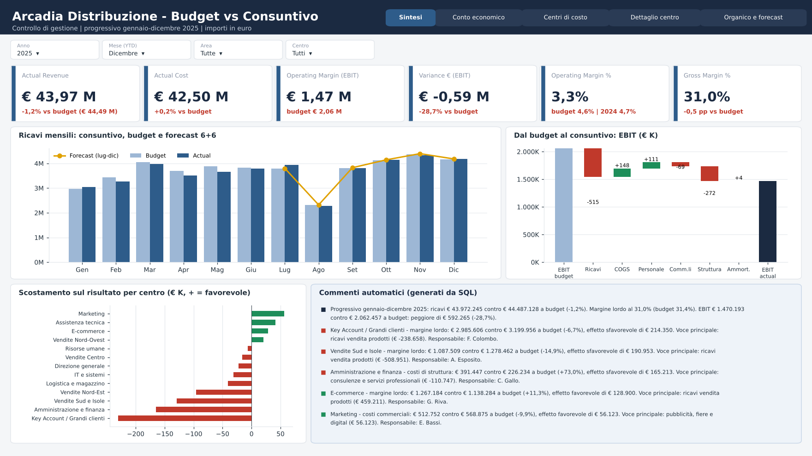
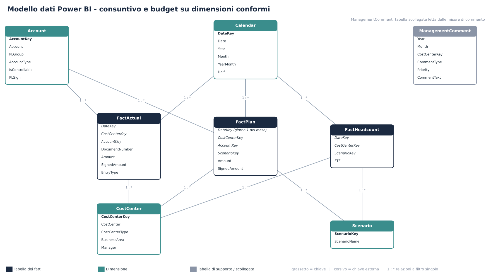
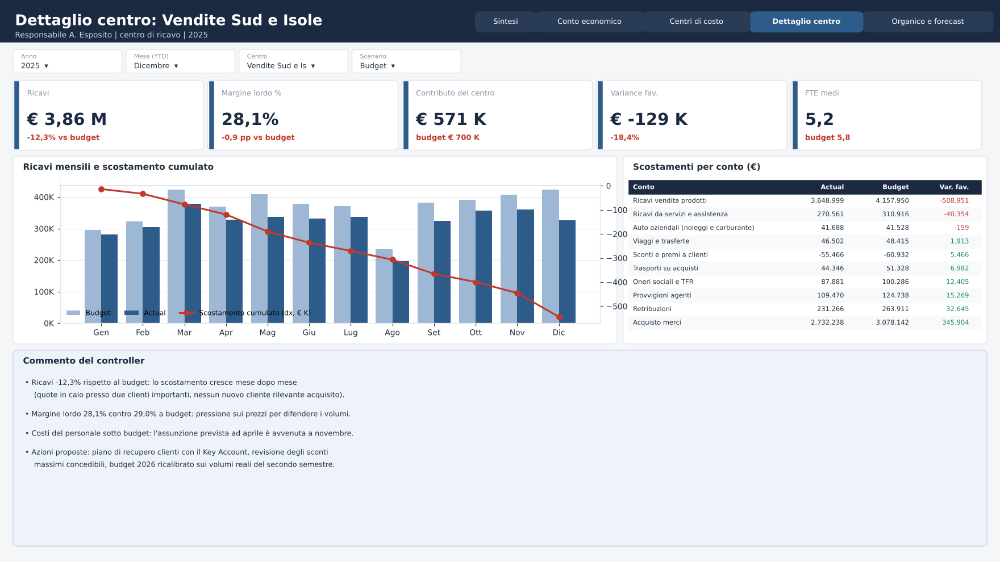
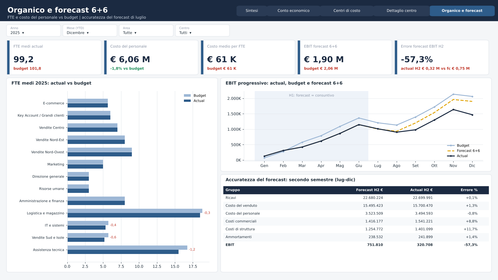

# Budget vs Consuntivo - controllo di gestione per centri di costo

**SQL Server · Power BI · DAX · Power Query · Python (generazione dati)**

Reporting di controllo di gestione per un'azienda commerciale con 13 centri di responsabilità: confronto mensile e progressivo tra consuntivo, budget e forecast 6+6, scostamenti letti con il segno giusto (favorevole / sfavorevole), performance di ogni centro e del suo responsabile, organico, e **commenti manageriali generati in automatico** da una procedura SQL.

Lo scenario è Arcadia Distribuzione S.r.l. (inventata): distribuzione B2B di prodotti IT e per l'ufficio con servizi di assistenza, circa 44 M€ di fatturato, sei centri di ricavo (quattro aree geografiche, Key Account, E-commerce) e sette centri di costo.



---

## Executive summary 2025

| | Actual | Budget | Scostamento | Forecast 6+6 | Actual 2024 |
|---|---:|---:|---:|---:|---:|
| Ricavi netti | 43,97 M€ | 44,49 M€ | -1,2% | 43,95 M€ | 41,31 M€ |
| Margine lordo % | 31,0% | 31,4% | -0,5 pp | | 31,7% |
| EBITDA | 1,95 M€ | 2,54 M€ | -23,5% | 2,37 M€ | 2,41 M€ |
| Risultato operativo (EBIT) | 1,47 M€ | 2,06 M€ | -28,7% | 1,90 M€ | 1,94 M€ |
| EBIT % sui ricavi | 3,3% | 4,6% | -1,3 pp | | 4,7% |
| FTE medi | 99,2 | 101,8 | -2,6 | | |

I ricavi mancano il budget di poco (-1,2%), ma in un'azienda di distribuzione con margini sottili basta questo, insieme a qualche costo di struttura fuori controllo, per perdere quasi il 30% del risultato operativo. Il forecast di luglio aveva visto solo una parte del problema: il secondo semestre ha chiuso con un EBIT di 0,32 M€ contro 0,75 M€ stimati.

## Il problema di business

Scenario di partenza:

- il budget veniva fatto in Excel e confrontato con il consuntivo una volta al trimestre, con un file per centro di costo;
- gli scostamenti erano presentati come semplice differenza: +100 k€ sui costi e +100 k€ sui ricavi sembravano la stessa cosa;
- i responsabili ricevevano numeri senza spiegazione e il controller passava due giorni a scrivere commenti a mano;
- il forecast di metà anno non veniva mai confrontato a posteriori con il consuntivo.

Obiettivi del progetto:

1. confrontare budget e risultati effettivi ogni mese, per centro e per conto;
2. evidenziare gli scostamenti rilevanti con il segno corretto (impatto sul risultato) e distinguere le voci controllabili dal responsabile;
3. misurare la performance di ogni centro di costo / ricavo;
4. produrre in automatico una prima bozza di commento manageriale;
5. verificare l'affidabilità del forecast.

## KPI

| KPI | Definizione |
|---|---|
| Budget Revenue / Actual Revenue | ricavi netti (prodotti + servizi - sconti e premi) |
| Budget Cost / Actual Cost | costo del venduto + costi operativi + ammortamenti |
| Variance € | Actual - Budget |
| Variance % | Variance € / \|Budget\| |
| Variance favorevole | (Actual - Budget) × segno del conto: positivo = migliora il risultato |
| Operating Margin | risultato operativo (EBIT) e sua incidenza sui ricavi |
| Cost Center Performance | risultato del centro (contributo per i centri di ricavo, costi per i centri di costo) vs budget |
| Variance controllabile | variance escluse le voci non controllabili dal responsabile (affitti, ammortamenti) |
| Budget consumato % | costi actual / costi a budget |

## Struttura del repository

```
budget-vs-actual/
├── data/                       prima nota, budget/forecast, organico, anagrafiche
├── python/generate_data.py     generazione del dataset (budget costruito dal consuntivo dell'anno prima)
├── sql/
│   ├── 01_create_database_and_tables.sql
│   ├── 02_populate_dim_date.sql
│   ├── 03_load_staging.sql
│   ├── 04_load_dw.sql
│   ├── 05_reporting_views.sql          include rpt.vw_BudgetVsActualMonthly
│   ├── 06_management_comments.sql      procedura dei commenti automatici
│   ├── 07_analysis_queries.sql
│   └── 08_data_quality_checks.sql
├── powerbi/
│   ├── measures.dax
│   └── power_query.m
├── docs/
│   ├── data_dictionary.md
│   └── dashboard_layout.md
└── images/
```

## Dataset

| File | Righe | Contenuto |
|---|---:|---|
| gl_actual_entries.csv | 31.437 | righe di prima nota 2024-2025 con centro di costo, conto, documento, controparte |
| budget_forecast.csv | 3.348 | budget mensile 2024 e 2025, forecast 6+6 2025, per centro e conto |
| headcount.csv | 624 | FTE mensili a budget e a consuntivo per centro |
| cost_centers.csv | 13 | centri con tipo, area e responsabile |
| chart_of_accounts.csv | 18 | conti economici con gruppo, segno e flag di controllabilità |

Come ho costruito i dati, cercando di imitare il processo reale:

- **Budget 2025** = consuntivo 2024 × ipotesi per centro (crescita dei ricavi dal 4% delle aree mature al 25% dell'e-commerce, margine +0,3 pp grazie ai nuovi listini, rinnovo CCNL +2,5%, cinque assunzioni con mese di ingresso), fasato mese per mese sulla stagionalità del 2024.
- **Consuntivo 2025** con scostamenti che hanno una causa precisa: area Sud in calo progressivo, contratto quadro del Key Account partito a luglio invece che ad aprile, e-commerce sopra le attese, tariffe dei corrieri +11% contro +3% a budget, consulenze per il nuovo ERP non previste, progetto di cybersecurity partito a maggio, campagne marketing spostate nel secondo semestre, assunzioni in ritardo.
- **Forecast 6+6** (luglio): gennaio-giugno = consuntivo, luglio-dicembre = budget corretto con metà del trend del primo semestre (approccio prudente), più le correzioni note (ERP, Key Account, Sud).
- Le righe di prima nota hanno numero documento, data, descrizione e controparte; a fine anno ci sono anche scritture di assestamento (ratei, accantonamento rischi su crediti, rettifiche trasporti).

## Database SQL Server

- Due tabelle dei fatti a grana diversa: `FactActual` (riga di prima nota, giornaliera) e `FactPlan` (mese × centro × conto × scenario). Il budget è registrato sul primo giorno del mese, così le due tabelle condividono lo stesso calendario.
- `DimScenario` (Actual, Budget, Forecast) e `FactHeadcount` per l'organico.
- La vista `rpt.vw_BudgetVsActualMonthly` unisce consuntivo e piani con un `FULL OUTER JOIN`: serve a non perdere né i costi senza budget né il budget senza consuntivo (entrambi i casi esistono e sono interessanti).
- `VarianceFavorable = (Actual - Budget) × PLSign`: un solo numero che dice se lo scostamento migliora o peggiora il risultato, sommabile tra ricavi e costi.

### Commenti manageriali automatici

La procedura `rpt.usp_GenerateManagementComments` (script 06) gira per ogni mese chiuso e scrive in `dw.ManagementComment`:

1. una **sintesi** a livello azienda (ricavi, margine lordo, EBIT vs budget);
2. i **3 scostamenti sfavorevoli e i 2 favorevoli** più rilevanti per centro × gruppo di costo, con la voce che pesa di più e il nome del responsabile. Ricavi e costo del venduto sono letti insieme come margine lordo: separati, un minor costo del venduto dovuto a minori vendite sembrerebbe una buona notizia;
3. una **riga per ogni centro**;
4. le differenze di **organico** rispetto al budget;
5. il confronto con il **forecast** (o la chiusura d'anno a dicembre).

Le soglie (20 k€ e 3%) sono parametri. Esempio reale di output per dicembre 2025:

> Progressivo gennaio-dicembre 2025: ricavi € 43.972.245 contro € 44.487.128 a budget (-1,2%). Margine lordo al 31,0% (budget 31,4%). EBIT € 1.470.193 contro € 2.062.457 a budget: peggiore di € 592.265 (-28,7%).

> Key Account / Grandi clienti - margine lordo: € 2.985.606 contro € 3.199.956 a budget (-6,7%), effetto sfavorevole di € 214.350. Voce principale: ricavi vendita prodotti (€ -238.658). Responsabile: F. Colombo.

> Amministrazione e finanza - costi di struttura: € 391.447 contro € 226.234 a budget (+73,0%), effetto sfavorevole di € 165.213. Voce principale: consulenze e servizi professionali (€ -110.747). Responsabile: C. Gallo.

Non sostituisce il commento del controller, ma gli dà una bozza corretta nei numeri da cui partire. In Power BI c'è anche una versione "live" in DAX (`[Dynamic Commentary]`) che si aggiorna con qualsiasi filtro.

## Modello Power BI



Misure principali (tutte commentate in `powerbi/measures.dax`):

```dax
Variance Fav € =
SUMX (
    VALUES ( Account[PLSign] ),
    ( [Actual] - [Budget] ) * Account[PLSign]
)
```

```dax
Operating Margin YTD Budget =
VAR _LastClosed = [Last Actual DateKey]
RETURN
    CALCULATE (
        [Budget Operating Margin],
        DATESYTD ( 'Calendar'[Date] ),
        'Calendar'[DateKey] <= _LastClosed
    )
```

```dax
FTE Actual =
AVERAGEX (
    VALUES ( 'Calendar'[YearMonth] ),
    CALCULATE ( SUM ( FactHeadcount[FTE] ), Scenario[ScenarioName] = "Actual" )
)
```

La prima è il cuore del progetto: con `SUMX` sul segno lo scostamento favorevole si calcola correttamente anche nelle righe di totale, dove ricavi e costi sono mescolati. La seconda limita il budget progressivo ai mesi già chiusi, per un confronto omogeneo a metà anno. La terza tratta l'organico come grandezza non additiva nel tempo (media dei mesi, non somma).

## Dashboard

Le immagini sono i mockup delle pagine, costruiti con i dati del progetto. Il dettaglio dei visual è in [docs/dashboard_layout.md](docs/dashboard_layout.md).

| Pagina | Contenuto |
|---|---|
| Sintesi | 6 KPI vs budget, ricavi mensili actual / budget / forecast, ponte EBIT budget → actual, scostamento per centro, commenti automatici |
| Conto economico | CE per natura con actual, budget, variance favorevole € e %, forecast, anno precedente |
| Centri di costo | tabella di performance con stato (favorevole / attenzione / sfavorevole), heatmap delle variance mensili per centro |
| Dettaglio centro | pagina di drill-through: trend mensile e scostamento cumulato, variance per conto, FTE, commento |
| Organico e forecast | FTE e costo del personale vs budget, EBIT progressivo actual / budget / forecast, accuratezza del forecast H2 |






## Cosa emerge dai dati

1. **Lo scostamento sull'EBIT (-592 k€) nasce da tre cose**: margine lordo -366 k€ (ricavi -515 k€ in parte compensati da minor costo del venduto), costi di struttura -272 k€, costi commerciali -69 k€. Il personale invece è sotto budget di 111 k€, ma solo perché le assunzioni sono arrivate in ritardo: non è un risparmio strutturale.
2. **Key Account (-231 k€ di contributo)**: il contratto quadro con il nuovo cliente bancario è partito a luglio invece che ad aprile; da luglio i volumi sono sopra budget ma i tre mesi persi non si recuperano.
3. **Vendite Sud e Isole (-18% di contributo, ricavi -12%)**: è l'unico problema di tendenza e non di calendario, lo scostamento cresce ogni mese e il margine è sceso di 0,9 pp per difendere i volumi. È il centro su cui intervenire nel budget 2026.
4. **Amministrazione e finanza +73% sui costi di struttura**: consulenze per il nuovo ERP (+137 k€ sul conto consulenze a livello azienda) e accantonamento rischi su crediti più alto. Spesa una tantum, ma non era a budget.
5. **Trasporti su vendite +9% vs budget**: le tariffe dei corrieri sono aumentate dell'11% contro il 3% previsto. È una voce che a budget andrebbe legata ai volumi con un'ipotesi di prezzo esplicita.
6. **E-commerce è la buona notizia**: ricavi +13% sul budget e +129 k€ di margine lordo, anche se una parte se ne va in pubblicità digitale (+20% sul budget del canale).
7. **Il forecast di luglio era troppo ottimista sul secondo semestre** (EBIT H2 0,32 M€ contro 0,75 M€). Aveva preso metà del risparmio sul marketing del primo semestre, che invece era solo uno spostamento delle campagne, e aveva sottostimato consulenze e licenze software. Lezione: separare gli scostamenti di calendario da quelli strutturali prima di proiettarli.

## Limiti

- Il modello si ferma al risultato operativo (niente gestione finanziaria e imposte).
- I costi di struttura non sono ribaltati sui centri di ricavo: il "contributo" dei centri di ricavo è un primo margine di contribuzione, non un risultato pieno. Un'estensione naturale è un ribaltamento per driver (ricavi, FTE, metri quadri).
- Il forecast è uno solo (6+6); con forecast trimestrali si potrebbe misurare come migliora l'accuratezza avvicinandosi a fine anno.

## Come riprodurre

1. (opzionale) `python python/generate_data.py`
2. Script SQL da 01 a 06 (nel 03 impostare `@DataPath`), poi 08 per i controlli
3. In Power BI: parametri `ServerName` e `DatabaseName`, query da `powerbi/power_query.m`, relazioni come nello schema, misure da `powerbi/measures.dax`

---

Andrea Pollastrelli · [Portfolio](https://andreapollastrelli95.github.io/)

Dati interamente simulati: aziende e persone sono di fantasia.
