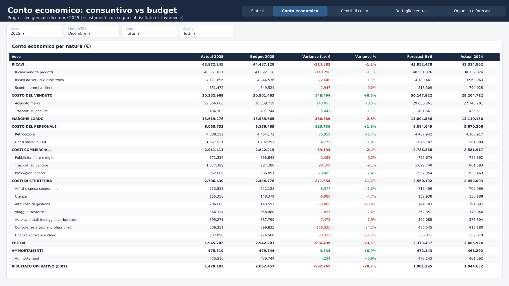
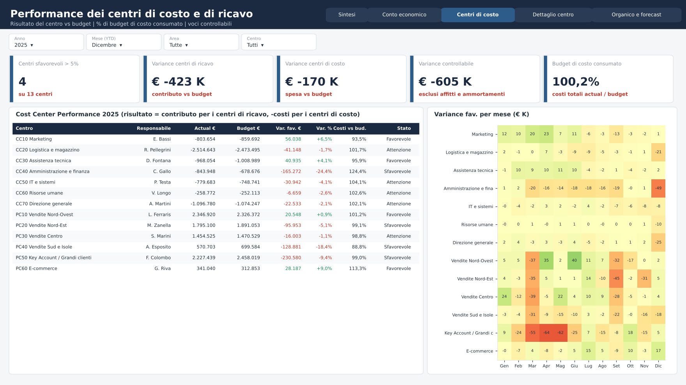

# Dashboard Budget vs Consuntivo

Dashboard di controllo di gestione per un'azienda commerciale con vari centri di responsabilità

Obiettivi del progetto:

- Confronto mensile tra risultati effettivi, budget e forecast.

- Analisi degli scostamenti favorevoli e sfavorevoli.

- Monitoraggio di ricavi, costi, margini, EBITDA ed EBIT.

- Analisi delle performance per centro di costo e responsabile.

- Monitoraggio dell'organico e dei costi del personale.

- Generazione automatica di commenti manageriali tramite SQL.

Dashboard Power BI composta da pagine interattive.

Dati interamente simulati
